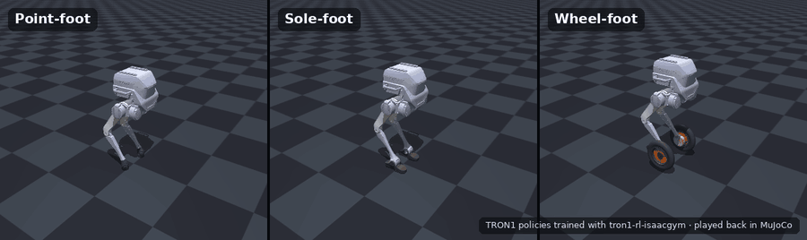

English | [中文](README_cn.md)

# TRON1 RL (Isaac Gym)

**Train locomotion policies for all three LimX TRON1 configurations — point-foot, sole-foot and wheel-foot — with massively parallel reinforcement learning in NVIDIA Isaac Gym.** The trained policies export to ONNX and run unchanged in [MuJoCo](https://github.com/limxdynamics/tron1-mujoco-sim) and on the real robot.

[](LICENSE)


[](https://github.com/limxdynamics/tron1-rl-isaacgym/stargazers)

<p align="center">
  
  <br>
  <sub>Policies trained with this repository, played back in MuJoCo (sim-to-sim).</sub>
</p>

## Highlights

- **One codebase, three robots.** Point-foot, sole-foot (with ankles) and wheel-foot TRON1, selected with a single environment variable.
- **Train → sim-to-sim → real.** Export to ONNX, verify in MuJoCo, then deploy with the official ROS / ROS 2 / Python controllers.
- **Thousands of parallel environments** (8192 by default) on a single GPU, built on [legged_gym](https://github.com/leggedrobotics/legged_gym) and [rsl_rl](https://github.com/leggedrobotics/rsl_rl).
- **Want to see it first?** Pre-trained Isaac Gym policies for every configuration ship with [tron1-rl-deploy-python](https://github.com/limxdynamics/tron1-rl-deploy-python/tree/main/controllers/model) — run them in MuJoCo without training anything.

## Supported robots

All configurations are trained with the same command and `--task=pointfoot_flat`; `ROBOT_TYPE` picks the robot, environment and reward set.

| Configuration | `ROBOT_TYPE` | Environment | Default iterations |
|---|---|---|---|
| Point-foot | `PF_TRON1A` (also `PF_P441A`, `PF_P441B`, `PF_P441C`, `PF_P441C2`) | `envs/pointfoot_flat` | 15000 |
| Sole-foot | `SF_TRON1A` | `envs/solefoot_flat` | 10000 |
| Wheel-foot | `WF_TRON1A` | `envs/wheelfoot_flat` | 8000 |

## How it fits together

```
tron1-robot-description ──► tron1-rl-isaacgym ──► ONNX policy ──► tron1-mujoco-sim ──► tron1-rl-deploy-{ros, ros2, python} ──► TRON1
      (robot models)          (train here)                       (sim-to-sim check)          (run on the real robot)
```

## Installation

Requirements: Linux with an NVIDIA GPU and driver that supports CUDA 12.1.

1. Create a Python 3.8 environment (Isaac Gym supports Python 3.6–3.8):
   ```bash
   conda create -n tron1_rl python=3.8 -y
   conda activate tron1_rl
   ```
2. Install PyTorch with CUDA 12.1:
   ```bash
   pip install torch==2.2.2 torchvision==0.17.2 torchaudio==2.2.2 --index-url https://download.pytorch.org/whl/cu121
   ```
3. Install Isaac Gym Preview 4 (Preview 3 also works; Preview 2 does not). Download it from [NVIDIA](https://developer.nvidia.com/isaac-gym), then:
   ```bash
   cd isaacgym/python && pip install -e .
   cd examples && python 1080_balls_of_solitude.py   # sanity check
   ```
   For troubleshooting, see `isaacgym/docs/index.html`.
4. Install this repository:
   ```bash
   git clone https://github.com/limxdynamics/tron1-rl-isaacgym.git
   cd tron1-rl-isaacgym && pip install -e .
   ```

On a fresh Ubuntu machine, [`install.sh`](install.sh) automates these steps, including the NVIDIA driver and Anaconda.

## Usage

### Train

```bash
export ROBOT_TYPE=PF_TRON1A        # or SF_TRON1A / WF_TRON1A
python legged_gym/scripts/train.py --task=pointfoot_flat --headless
```

- `--headless` disables rendering. If you keep the viewer open, press `v` to pause rendering and speed up training.
- On a smaller GPU, reduce the number of environments with `--num_envs 4096`.
- To run on CPU: `--sim_device=cpu --rl_device=cpu` (simulating on CPU and learning on GPU also works).
- Checkpoints are saved to `logs/pointfoot_flat/<experiment_name>/<date_time>_<run_name>/model_<iteration>.pt`. `experiment_name` defaults to the `ROBOT_TYPE`.

Common arguments (override the values in the config files):

| Argument | Meaning |
|---|---|
| `--resume` | Resume training from a checkpoint |
| `--load_run RUN` | Run folder to load when resuming (`-1` = latest) |
| `--checkpoint N` | Checkpoint iteration to load (`-1` = latest) |
| `--experiment_name NAME` / `--run_name NAME` | Name of the experiment / run |
| `--num_envs N` | Number of parallel environments |
| `--max_iterations N` | Maximum training iterations |
| `--seed SEED` | Random seed |

### Play and export

```bash
python legged_gym/scripts/play.py --task=pointfoot_flat --load_run <run_folder> --checkpoint <iteration>
```

- `load_run` is the run folder name, e.g. `Apr18_15-48-46_`; `checkpoint` is the iteration number, e.g. `10000` for `model_10000.pt`.
- `play.py` also exports the policy to `logs/pointfoot_flat/<experiment_name>/exported/policies/` as `policy.onnx` and `encoder.onnx`.

### Deploy

Copy `policy.onnx` and `encoder.onnx` into `controllers/model/<ROBOT_TYPE>/policy/isaacgym/` of [tron1-rl-deploy-python](https://github.com/limxdynamics/tron1-rl-deploy-python) (or the ROS / ROS 2 equivalent), check the behaviour in [tron1-mujoco-sim](https://github.com/limxdynamics/tron1-mujoco-sim), then run it on the robot.

## Code structure

- Each environment is defined by an env file and a config file, e.g. `pointfoot_flat.py` and `pointfoot_flat_config.py`. The config holds the environment parameters (`BipedCfgPF`) and the training parameters (`BipedCfgPPOPF`); both use inheritance.
- Every non-zero reward scale in the config adds the reward function with the matching name to the total reward.
- Tasks are registered with `task_registry.register(name, EnvClass, EnvConfig, TrainConfig)` in `legged_gym/envs/__init__.py`, or from outside the repository.

## Related repositories

| Repository | Description |
|---|---|
| [tron1-robot-description](https://github.com/limxdynamics/tron1-robot-description) | TRON1 URDF / MJCF models |
| [tron1-rl-isaaclab](https://github.com/limxdynamics/tron1-rl-isaaclab) | RL training on Isaac Lab, the actively developed successor of Isaac Gym |
| [tron1-mujoco-sim](https://github.com/limxdynamics/tron1-mujoco-sim) | MuJoCo simulator for sim-to-sim validation |
| [tron1-rl-deploy-python](https://github.com/limxdynamics/tron1-rl-deploy-python) | Policy deployment in Python, with pre-trained policies |
| [tron1-rl-deploy-ros](https://github.com/limxdynamics/tron1-rl-deploy-ros) / [ros2](https://github.com/limxdynamics/tron1-rl-deploy-ros2) | Policy deployment on ROS / ROS 2 |

New to TRON1 RL and not tied to Isaac Gym? Isaac Gym is no longer updated by NVIDIA; consider starting with [tron1-rl-isaaclab](https://github.com/limxdynamics/tron1-rl-isaaclab).

## Known issues

When simulating on GPU with a triangle-mesh terrain, the contact forces reported by `net_contact_force_tensor` are unreliable. See the [legged_gym known issues](https://github.com/leggedrobotics/legged_gym#known-issues) for the force-sensor workaround.

## Acknowledgment

This project builds on [legged_gym](https://github.com/leggedrobotics/legged_gym) and [rsl_rl](https://github.com/leggedrobotics/rsl_rl) by the Robotic Systems Lab, ETH Zurich. We use their `LeggedRobot` implementation as the foundation of our environments.

## Questions?

Please [open an issue](https://github.com/limxdynamics/tron1-rl-isaacgym/issues). If this project helps your work, a ⭐ helps others find it.
