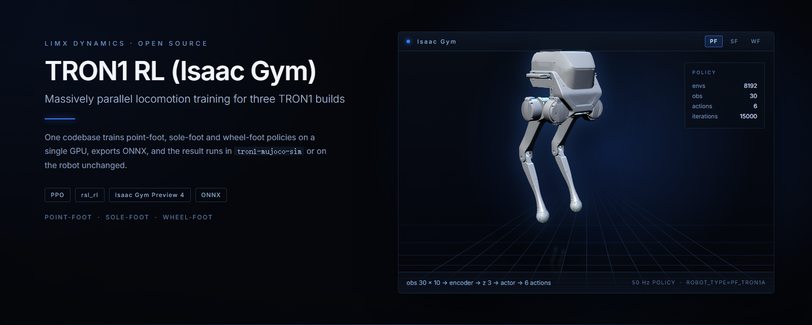
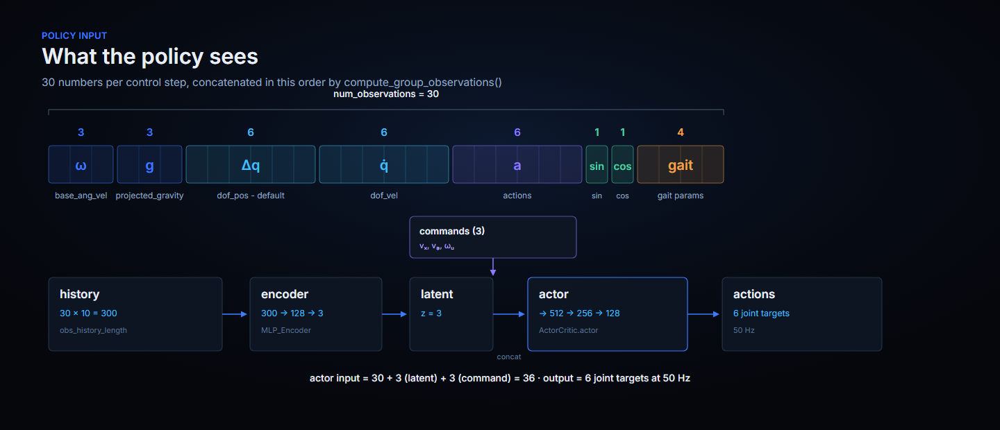
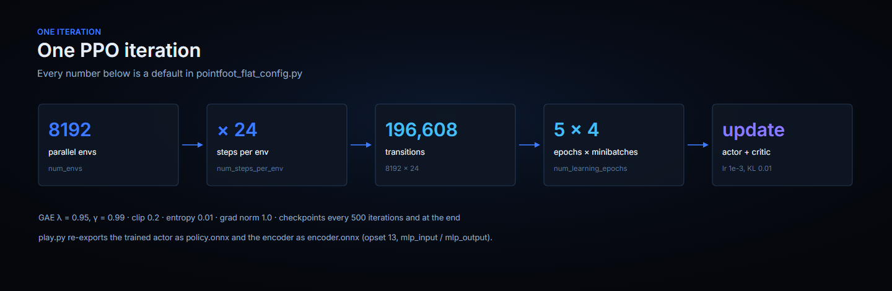

<p align="center">
  
</p>

<p align="center">
  <b>English</b> | <a href="README_cn.md">中文</a>
</p>

<p align="center">
  <a href="LICENSE"></a>
  
  
  
</p>

# TRON1 RL (Isaac Gym)

Train locomotion policies for all three LimX TRON1 configurations — point-foot,
sole-foot and wheel-foot — with 8192 environments in parallel on a single GPU.
The trained actor exports to ONNX and runs unchanged in
[tron1-mujoco-sim](https://github.com/limxdynamics/tron1-mujoco-sim) and on the robot.

**Scope.** This is the Isaac Gym trainer, kept for people already working in Isaac
Gym. NVIDIA has deprecated it in favour of Isaac Lab; new projects should start
from [tron1-rl-isaaclab](https://github.com/limxdynamics/tron1-rl-isaaclab). The
policy interface and the deployment path are the same.

## Highlights

- **One codebase, three robots.** Point-foot, sole-foot (parallel-linkage ankles)
  and wheel-foot (driven wheels) share the training loop; `ROBOT_TYPE` picks the
  environment, the reward set and the actuator config.
- **8192 environments per GPU.** 196,608 transitions per iteration, 24 env steps
  apart, so a policy sees minutes of walking per update instead of seconds.
- **Train → sim-to-sim → real.** `play.py` exports `policy.onnx` and
  `encoder.onnx`; the same files drop into MuJoCo for a second physics check and
  then onto the robot.
- **No policy to train.** Pre-trained Isaac Gym policies for every configuration
  ship with
  [tron1-rl-deploy-python](https://github.com/limxdynamics/tron1-rl-deploy-python/tree/main/controllers/model)
  — watch them walk without a GPU.

## Configurations

Each card is rendered from that model's URDF in `resources/robots/`. The numbers
come from the three `*_config.py` files: all three train at **50 Hz**, reached by
`decimation × dt` (4 × 5 ms, 8 × 2.5 ms, 4 × 5 ms), which is the same control rate
the shipped deployment code uses (500 Hz loop, decimation 10).

| Rendering | Configuration | Description | DOF | Format |
|:--:|---|---|:--:|---|
|  | **Point-foot**<br>`PF_TRON1A` | Ball feet, six actuated joints. Also covers the `PF_P441*` variants. | 6 | URDF/STL |
|  | **Sole-foot**<br>`SF_TRON1A` | Flat feet on parallel-linkage ankles; two extra joints to balance. | 8 | URDF/STL |
|  | **Wheel-foot**<br>`WF_TRON1A` | Driven wheels instead of feet; the wheel joints are part of the action space. | 8 | URDF/STL |

| | Point-foot | Sole-foot | Wheel-foot |
|---|:--:|:--:|:--:|
| `ROBOT_TYPE` | `PF_TRON1A`, `PF_P441A`…`C2` | `SF_TRON1A` | `WF_TRON1A` |
| `num_envs` | 8192 | 8192 | 8192 |
| Observations per step | 30 | 36 | 28 |
| Observation history | × 10 | × 5 | × 10 |
| Actor input (obs + latent + command) | 36 | 44 | 34 |
| Actions | 6 | 8 | 8 |
| Commands | 3 | 5 | 3 |
| `max_iterations` | 15000 | 10000 | 8000 |

All three are trained with the same command and task name —
`--task=pointfoot_flat` — because `ROBOT_TYPE` selects the environment module at
import time (`legged_gym/envs/__init__.py`).

## TRON1 open-source ecosystem

TRON1 is supported by a set of open-source repositories, from robot models to the real robot. This section is the map; the other TRON1 repositories link back here.

```
tron1-robot-description ──► tron1-rl-isaaclab / tron1-rl-isaacgym ──► ONNX policy ──► tron1-mujoco-sim ──► tron1-rl-deploy-{ros, ros2, python} ──► TRON1
      (robot models)                  (train)                                       (sim-to-sim check)          (run on the real robot)
```

**Where to start**

- **No robot yet?** Run the pre-trained policies from [tron1-rl-deploy-python](https://github.com/limxdynamics/tron1-rl-deploy-python) in [tron1-mujoco-sim](https://github.com/limxdynamics/tron1-mujoco-sim). Nothing to train.
- **Train your own policy:** start new projects with [tron1-rl-isaaclab](https://github.com/limxdynamics/tron1-rl-isaaclab) (NVIDIA has deprecated Isaac Gym in favour of Isaac Lab), or use this repository if you already work with Isaac Gym.
- **Run on the robot:** deploy the exported ONNX policy with [tron1-rl-deploy-ros](https://github.com/limxdynamics/tron1-rl-deploy-ros), [tron1-rl-deploy-ros2](https://github.com/limxdynamics/tron1-rl-deploy-ros2) or [tron1-rl-deploy-python](https://github.com/limxdynamics/tron1-rl-deploy-python).

| Stage | Repository | What it does |
|---|---|---|
| Robot model | [tron1-robot-description](https://github.com/limxdynamics/tron1-robot-description) | URDF / Xacro / MJCF models for ROS 1/2, MuJoCo and Gazebo |
| Simulation | [tron1-mujoco-sim](https://github.com/limxdynamics/tron1-mujoco-sim) | MuJoCo simulator with the same `limxsdk` interface as the robot |
| Simulation | [tron1-gazebo-ros](https://github.com/limxdynamics/tron1-gazebo-ros) · [tron1-gazebo-ros2](https://github.com/limxdynamics/tron1-gazebo-ros2) | Gazebo simulation on ROS Noetic · ROS 2 Iron |
| Training | [tron1-rl-isaaclab](https://github.com/limxdynamics/tron1-rl-isaaclab) | RL training on Isaac Lab, recommended for new projects |
| Training | **tron1-rl-isaacgym** (this repository) | RL training on Isaac Gym |
| Deployment | [tron1-rl-deploy-python](https://github.com/limxdynamics/tron1-rl-deploy-python) | Python deployment, with pre-trained policies |
| Deployment | [tron1-rl-deploy-ros](https://github.com/limxdynamics/tron1-rl-deploy-ros) · [tron1-rl-deploy-ros2](https://github.com/limxdynamics/tron1-rl-deploy-ros2) | Deployment on ROS Noetic · ROS 2 Iron |
| Deployment | [tron1-rl-deploy-arm](https://github.com/limxdynamics/tron1-rl-deploy-arm) | RL deployment for TRON1 with the arm |
| Applications | [tron1-ss](https://github.com/limxdynamics/tron1-ss) | LiDAR SLAM and navigation: mapping, localization, path planning |
| Applications | [tron1-agent](https://github.com/limxdynamics/tron1-agent) | Voice-interactive AI agent: speech commands, LLM dialogue, robot actions |
| SDK | [limxsdk-lowlevel](https://github.com/limxdynamics/limxsdk-lowlevel) | Low-level motion control SDK (C++ / Python) used by the simulators and deployment code |

## What the policy sees

The observation is assembled in `compute_group_observations()`: eight fields
concatenated in a fixed order, nothing normalised away. The history stack is what
gives the encoder its temporal window — 30 numbers × 10 steps for point-foot.

<p align="center">
  
</p>

The rest of the contract, read from the shipped `policy.onnx` and `encoder.onnx`:

| | Encoder | Policy |
|---|---|---|
| Input | `mlp_input`, shape `[300]` | `mlp_input`, shape `[36]` |
| Output | `mlp_output`, shape `[3]` | `mlp_output`, shape `[6]` |
| Opset | 13 | 13 |

## One training iteration

<p align="center">
  
</p>

## Quick start: read a trained policy in 30 seconds

No GPU, no Isaac Gym, no build. The shipped point-foot policy is a ~760 KB ONNX
file, and its interface is the whole story:

```bash
pip install onnx
curl -L -o policy.onnx https://github.com/limxdynamics/tron1-rl-deploy-python/raw/main/controllers/model/PF_TRON1A/policy/isaacgym/policy.onnx
python -c "import onnx; m = onnx.load('policy.onnx'); print([d.dim_value for d in m.graph.input[0].type.tensor_type.shape.dim], '->', [d.dim_value for d in m.graph.output[0].type.tensor_type.shape.dim])"
```

It prints `[36] -> [6]`: 30 observations plus a 3-dim latent plus 3 commands in,
six joint targets out. To watch that policy move rather than read it, run it in
[tron1-mujoco-sim](https://github.com/limxdynamics/tron1-mujoco-sim) — that needs
no training at all.

## Installation

Requirements: Linux with an NVIDIA GPU and driver that supports CUDA 12.1.

1. Create a Python 3.8 environment (Isaac Gym supports Python 3.6–3.8):
   ```bash
   conda create -n tron1_rl python=3.8 -y
   conda activate tron1_rl
   ```
2. Install PyTorch with CUDA 12.1:
   ```bash
   pip install torch==2.2.2 torchvision==0.17.2 torchaudio==2.2.2 --index-url https://download.pytorch.org/whl/cu121
   ```
3. Install Isaac Gym Preview 4 (Preview 2 will not work). Download it from [NVIDIA](https://developer.nvidia.com/isaac-gym), then:
   ```bash
   cd isaacgym/python && pip install -e .
   pip install "numpy<1.24"   # Isaac Gym uses np.float, which was removed in NumPy 1.24
   cd examples && python 1080_balls_of_solitude.py   # sanity check
   ```
   For troubleshooting, see `isaacgym/docs/index.html`.
4. Install this repository and the logging / export dependencies:
   ```bash
   git clone https://github.com/limxdynamics/tron1-rl-isaacgym.git
   cd tron1-rl-isaacgym && pip install -e .
   pip install onnx tensorboard==2.12.0
   ```

On a fresh Ubuntu machine, [`install.sh`](install.sh) automates these steps, including the NVIDIA driver and Anaconda. It installs everything under `~/limx_rl` in a conda environment named `pointfoot_legged_gym`.

## Usage

### Train

```bash
export ROBOT_TYPE=PF_TRON1A        # or SF_TRON1A / WF_TRON1A
python legged_gym/scripts/train.py --task=pointfoot_flat --headless
```

- `--headless` disables rendering. If you keep the viewer open, press `v` to pause rendering and speed up training.
- On a smaller GPU, reduce the number of environments with `--num_envs 4096`.
- To run on CPU: `--sim_device=cpu --rl_device=cpu` (simulating on CPU and learning on GPU also works).
- Checkpoints are saved to `logs/pointfoot_flat/<experiment_name>/<date_time>_<run_name>/model_<iteration>.pt`. `experiment_name` defaults to the `ROBOT_TYPE`.

Common arguments (override the values in the config files):

| Argument | Meaning |
|---|---|
| `--resume` | Resume training from a checkpoint |
| `--load_run RUN` | Run folder to load; defaults to the latest run |
| `--checkpoint N` | Checkpoint iteration to load; defaults to the latest checkpoint |
| `--experiment_name NAME` / `--run_name NAME` | Name of the experiment / run |
| `--num_envs N` | Number of parallel environments |
| `--max_iterations N` | Maximum training iterations |
| `--seed SEED` | Random seed |

### Play and export

```bash
python legged_gym/scripts/play.py --task=pointfoot_flat                       # latest run, latest checkpoint
python legged_gym/scripts/play.py --task=pointfoot_flat --load_run Apr18_15-48-46_ --checkpoint 10000
```

- `load_run` is the run folder name; `checkpoint` is the iteration number, e.g. `10000` for `model_10000.pt`.
- "Latest run" is the last folder in alphabetical order. Folder names start with the month (`Apr…`, `Oct…`), so pass `--load_run` explicitly if your runs span several months.
- `play.py` also exports the policy to `logs/pointfoot_flat/<experiment_name>/exported/policies/` as `policy.onnx` and `encoder.onnx`.

### Deploy

Copy `policy.onnx` and `encoder.onnx` into `controllers/model/<ROBOT_TYPE>/policy/isaacgym/` of [tron1-rl-deploy-python](https://github.com/limxdynamics/tron1-rl-deploy-python) and run it with `export RL_TYPE=isaacgym`. Check the behaviour in [tron1-mujoco-sim](https://github.com/limxdynamics/tron1-mujoco-sim) first, then run it on the robot. For ROS / ROS 2, follow the README of [tron1-rl-deploy-ros](https://github.com/limxdynamics/tron1-rl-deploy-ros) / [tron1-rl-deploy-ros2](https://github.com/limxdynamics/tron1-rl-deploy-ros2).

## Code structure

- Each environment is defined by an env file and a config file, e.g. `pointfoot_flat.py` and `pointfoot_flat_config.py`. The config holds the environment parameters (`BipedCfgPF`) and the training parameters (`BipedCfgPPOPF`); both use inheritance.
- Every non-zero reward scale in the config adds the reward function with the matching name to the total reward.
- Tasks are registered with `task_registry.register(name, EnvClass, EnvConfig, TrainConfig)` in `legged_gym/envs/__init__.py`, or from outside the repository.

## Known issues

When simulating on GPU with a triangle-mesh terrain, the contact forces reported by `net_contact_force_tensor` are unreliable. See the [legged_gym known issues](https://github.com/leggedrobotics/legged_gym#known-issues) for the force-sensor workaround.

## Acknowledgment

This project builds on [legged_gym](https://github.com/leggedrobotics/legged_gym) and [rsl_rl](https://github.com/leggedrobotics/rsl_rl) by the Robotic Systems Lab, ETH Zurich. We use their `LeggedRobot` implementation as the foundation of our environments.

## License

[BSD-3-Clause](LICENSE). This repository is a fork of
[leggedrobotics/legged_gym](https://github.com/leggedrobotics/legged_gym), and the
upstream copyright notices are retained in the source files.

Security reports and contribution guidelines are handled at the organisation
level: [SECURITY.md](https://github.com/limxdynamics/.github/blob/main/SECURITY.md),
[CONTRIBUTING.md](https://github.com/limxdynamics/.github/blob/main/CONTRIBUTING.md).
