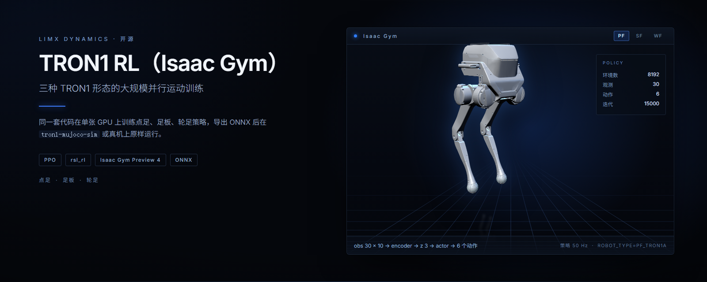
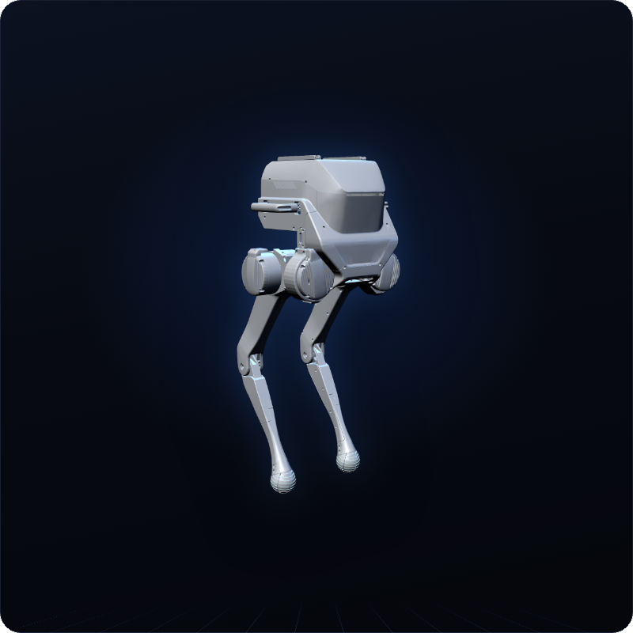
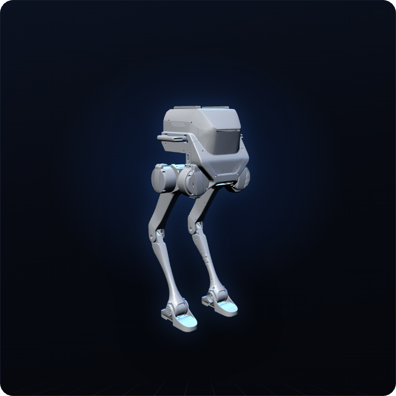
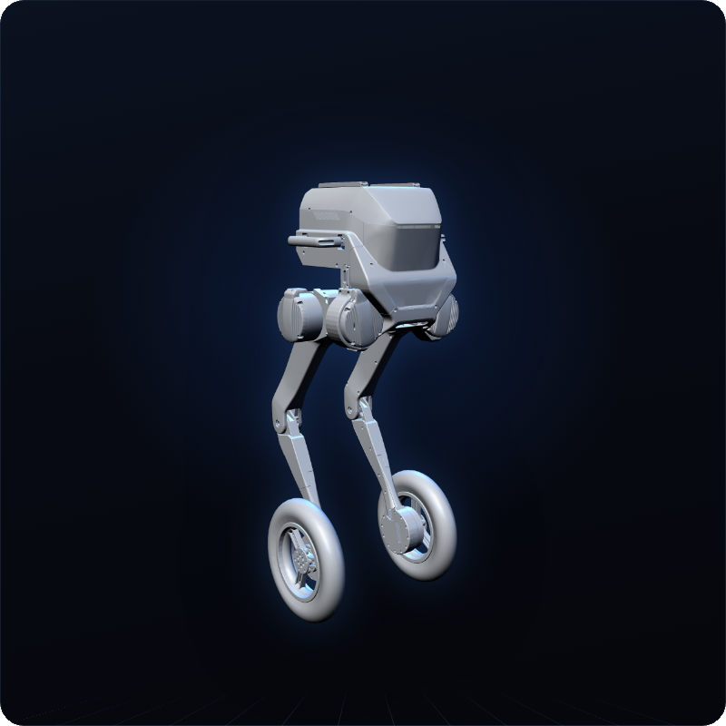
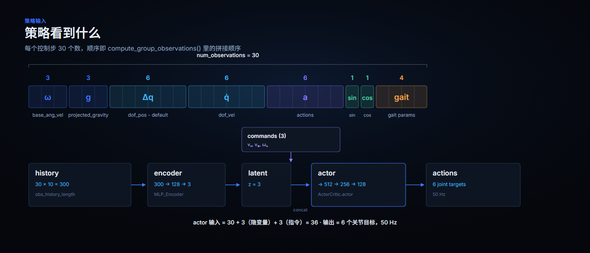
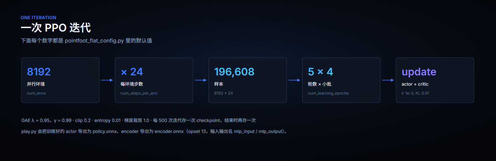

<p align="center">
  
</p>

<p align="center">
  <a href="README.md">English</a> | <b>中文</b>
</p>

<p align="center">
  <a href="LICENSE"></a>
  
  
  
</p>

# TRON1 RL (Isaac Gym)

在单张 GPU 上用 8192 个并行环境，为 LimX TRON1 的三种形态——点足、足板、轮足——
训练运动策略。训练好的 actor 导出为 ONNX，在
[tron1-mujoco-sim](https://github.com/limxdynamics/tron1-mujoco-sim) 和真机上原样运行。

**适用范围。** 本仓库是基于 Isaac Gym 的训练端，供已经在用 Isaac Gym 的人使用。
NVIDIA 已停止维护 Isaac Gym、改推 Isaac Lab，新项目建议从
[tron1-rl-isaaclab](https://github.com/limxdynamics/tron1-rl-isaaclab) 开始，两者的
策略接口和部署路径一致。

## 亮点

- **一套代码，三种机器人。** 点足、足板（平行连杆踝关节）与轮足（驱动轮）共用同一条
  训练循环；`ROBOT_TYPE` 决定用哪个环境、哪套奖励和哪组执行器参数。
- **单卡 8192 个环境。** 每次迭代 196,608 条样本、每条相隔 24 个环境步，一次更新看到的
  是几分钟的行走数据，而不是几秒。
- **训练 → sim-to-sim → 真机。** `play.py` 导出 `policy.onnx` 与 `encoder.onnx`，
  同一份文件先丢进 MuJoCo 用第二个物理引擎验一遍，再上真机。
- **不用自己训练。** 每种形态的预训练 Isaac Gym 策略都随
  [tron1-rl-deploy-python](https://github.com/limxdynamics/tron1-rl-deploy-python/tree/main/controllers/model)
  一起发布——没有 GPU 也能看它走。

## 型号一览

下表中每张卡片都由 `resources/robots/` 里对应型号的 URDF 渲染而来。数据取自三份
`*_config.py`：三种形态都以 **50 Hz** 训练，由 `decimation × dt` 得到（4 × 5 ms、
8 × 2.5 ms、4 × 5 ms），与发布出去的部署代码一致（500 Hz 循环、decimation 10）。

| 渲染图 | 型号 | 说明 | DOF | 格式 |
|:--:|---|---|:--:|---|
|  | **点足**<br>`PF_TRON1A` | 球形足端，六个主动关节。`PF_P441*` 系列同属这一形态。 | 6 | URDF/STL |
|  | **足板**<br>`SF_TRON1A` | 足板通过平行连杆踝关节连接，多两个关节用于平衡。 | 8 | URDF/STL |
|  | **轮足**<br>`WF_TRON1A` | 用驱动轮代替足端，轮关节本身也在动作空间里。 | 8 | URDF/STL |

| | 点足 | 足板 | 轮足 |
|---|:--:|:--:|:--:|
| `ROBOT_TYPE` | `PF_TRON1A`、`PF_P441A`…`C2` | `SF_TRON1A` | `WF_TRON1A` |
| `num_envs` | 8192 | 8192 | 8192 |
| 每步观测维度 | 30 | 36 | 28 |
| 观测历史长度 | × 10 | × 5 | × 10 |
| actor 输入（观测 + 隐变量 + 指令） | 36 | 44 | 34 |
| 动作维度 | 6 | 8 | 8 |
| 指令维度 | 3 | 5 | 3 |
| `max_iterations` | 15000 | 10000 | 8000 |

三种形态用的是同一条命令、同一个任务名 `--task=pointfoot_flat`——因为
`ROBOT_TYPE` 在 import 阶段就决定了加载哪个环境模块
（`legged_gym/envs/__init__.py`）。

## TRON1 开源生态

TRON1 有一整套开源仓库，覆盖从机器人模型到真机运行的全流程。这里是总导航，其他 TRON1 仓库都会链接到这里。

```
tron1-robot-description ──► tron1-rl-isaaclab / tron1-rl-isaacgym ──► ONNX 策略 ──► tron1-mujoco-sim ──► tron1-rl-deploy-{ros, ros2, python} ──► TRON1
       （机器人模型）                    （训练）                                     （sim-to-sim 验证）          （真机运行）
```

**从哪里开始**

- **还没有机器人？** 在 [tron1-mujoco-sim](https://github.com/limxdynamics/tron1-mujoco-sim) 里运行 [tron1-rl-deploy-python](https://github.com/limxdynamics/tron1-rl-deploy-python) 自带的预训练策略，不用训练就能看到效果。
- **训练自己的策略：** 新项目建议用 [tron1-rl-isaaclab](https://github.com/limxdynamics/tron1-rl-isaaclab)（NVIDIA 已停止维护 Isaac Gym、改推 Isaac Lab）；已经在用 Isaac Gym 的话，用本仓库即可。
- **在真机上运行：** 用 [tron1-rl-deploy-ros](https://github.com/limxdynamics/tron1-rl-deploy-ros)、[tron1-rl-deploy-ros2](https://github.com/limxdynamics/tron1-rl-deploy-ros2) 或 [tron1-rl-deploy-python](https://github.com/limxdynamics/tron1-rl-deploy-python) 部署导出的 ONNX 策略。

| 环节 | 仓库 | 作用 |
|---|---|---|
| 机器人模型 | [tron1-robot-description](https://github.com/limxdynamics/tron1-robot-description) | URDF / Xacro / MJCF 模型，支持 ROS 1/2、MuJoCo、Gazebo |
| 仿真 | [tron1-mujoco-sim](https://github.com/limxdynamics/tron1-mujoco-sim) | MuJoCo 仿真器，接口和真机一致（`limxsdk`） |
| 仿真 | [tron1-gazebo-ros](https://github.com/limxdynamics/tron1-gazebo-ros) · [tron1-gazebo-ros2](https://github.com/limxdynamics/tron1-gazebo-ros2) | Gazebo 仿真，ROS Noetic · ROS 2 Iron |
| 训练 | [tron1-rl-isaaclab](https://github.com/limxdynamics/tron1-rl-isaaclab) | 基于 Isaac Lab 的 RL 训练，新项目推荐 |
| 训练 | **tron1-rl-isaacgym**（本仓库） | 基于 Isaac Gym 的 RL 训练 |
| 部署 | [tron1-rl-deploy-python](https://github.com/limxdynamics/tron1-rl-deploy-python) | Python 部署，含预训练策略 |
| 部署 | [tron1-rl-deploy-ros](https://github.com/limxdynamics/tron1-rl-deploy-ros) · [tron1-rl-deploy-ros2](https://github.com/limxdynamics/tron1-rl-deploy-ros2) | ROS Noetic · ROS 2 Iron 部署 |
| 部署 | [tron1-rl-deploy-arm](https://github.com/limxdynamics/tron1-rl-deploy-arm) | 带机械臂的 TRON1 RL 部署 |
| 应用 | [tron1-ss](https://github.com/limxdynamics/tron1-ss) | 激光 SLAM 与导航：建图、定位、路径规划 |
| 应用 | [tron1-agent](https://github.com/limxdynamics/tron1-agent) | 语音交互 AI Agent：语音指令、大模型对话、机器人动作 |
| SDK | [limxsdk-lowlevel](https://github.com/limxdynamics/limxsdk-lowlevel) | 底层运动控制 SDK（C++ / Python），仿真和部署代码都依赖它 |

## 策略看到什么

观测在 `compute_group_observations()` 里拼装：八个字段按固定顺序拼接，不做额外归一化。
真正给编码器提供时间窗口的是历史堆叠——点足是 30 个数 × 10 步。

<p align="center">
  
</p>

其余接口约定，直接读发布的 `policy.onnx` 与 `encoder.onnx`：

| | encoder | policy |
|---|---|---|
| 输入 | `mlp_input`，形状 `[300]` | `mlp_input`，形状 `[36]` |
| 输出 | `mlp_output`，形状 `[3]` | `mlp_output`，形状 `[6]` |
| Opset | 13 | 13 |

## 一次 PPO 迭代

<p align="center">
  
</p>

## 30 秒快速开始：读一个训练好的策略

不需要 GPU、不需要 Isaac Gym、不需要编译。发布出来的点足策略是一个约 760 KB 的 ONNX
文件，它的接口本身就说明了全部：

```bash
pip install onnx
curl -L -o policy.onnx https://github.com/limxdynamics/tron1-rl-deploy-python/raw/main/controllers/model/PF_TRON1A/policy/isaacgym/policy.onnx
python -c "import onnx; m = onnx.load('policy.onnx'); print([d.dim_value for d in m.graph.input[0].type.tensor_type.shape.dim], '->', [d.dim_value for d in m.graph.output[0].type.tensor_type.shape.dim])"
```

输出 `[36] -> [6]`：30 维观测 + 3 维隐变量 + 3 维指令进，6 个关节目标出。想让它动起来
而不是只读接口，放到
[tron1-mujoco-sim](https://github.com/limxdynamics/tron1-mujoco-sim) 里跑即可，同样不需要训练。

## 安装

要求：Linux，NVIDIA GPU，驱动支持 CUDA 12.1。

1. 创建 Python 3.8 环境（Isaac Gym 支持 Python 3.6–3.8）：
   ```bash
   conda create -n tron1_rl python=3.8 -y
   conda activate tron1_rl
   ```
2. 安装 CUDA 12.1 版本的 PyTorch：
   ```bash
   pip install torch==2.2.2 torchvision==0.17.2 torchaudio==2.2.2 --index-url https://download.pytorch.org/whl/cu121
   ```
3. 安装 Isaac Gym Preview 4（Preview 2 不行）。从 [NVIDIA](https://developer.nvidia.com/isaac-gym) 下载后：
   ```bash
   cd isaacgym/python && pip install -e .
   pip install "numpy<1.24"   # Isaac Gym 用到 np.float，NumPy 1.24 起已移除
   cd examples && python 1080_balls_of_solitude.py   # 自检
   ```
   排错见 `isaacgym/docs/index.html`。
4. 安装本仓库与日志 / 导出依赖：
   ```bash
   git clone https://github.com/limxdynamics/tron1-rl-isaacgym.git
   cd tron1-rl-isaacgym && pip install -e .
   pip install onnx tensorboard==2.12.0
   ```

全新 Ubuntu 机器上，[`install.sh`](install.sh) 会自动完成以上步骤（含 NVIDIA 驱动与
Anaconda），统一装在 `~/limx_rl` 下，conda 环境名为 `pointfoot_legged_gym`。

## 使用方法

### 训练

```bash
export ROBOT_TYPE=PF_TRON1A        # 或 SF_TRON1A / WF_TRON1A
python legged_gym/scripts/train.py --task=pointfoot_flat --headless
```

- `--headless` 关闭渲染。如果保留可视化窗口，按 `v` 暂停渲染可以提速。
- GPU 显存较小时，用 `--num_envs 4096` 减少环境数。
- 纯 CPU 运行：`--sim_device=cpu --rl_device=cpu`（CPU 仿真 + GPU 学习也可以）。
- checkpoint 保存在 `logs/pointfoot_flat/<experiment_name>/<date_time>_<run_name>/model_<iteration>.pt`，`experiment_name` 默认取 `ROBOT_TYPE`。

常用参数（覆盖配置文件里的值）：

| 参数 | 含义 |
|---|---|
| `--resume` | 从 checkpoint 继续训练 |
| `--load_run RUN` | 要加载的 run 目录，默认取最新的 |
| `--checkpoint N` | 要加载的 checkpoint 迭代数，默认取最新的 |
| `--experiment_name NAME` / `--run_name NAME` | 实验名 / run 名 |
| `--num_envs N` | 并行环境数量 |
| `--max_iterations N` | 最大训练迭代次数 |
| `--seed SEED` | 随机种子 |

### 运行与导出

```bash
python legged_gym/scripts/play.py --task=pointfoot_flat                       # 最新 run、最新 checkpoint
python legged_gym/scripts/play.py --task=pointfoot_flat --load_run Apr18_15-48-46_ --checkpoint 10000
```

- `load_run` 是 run 目录名，`checkpoint` 是迭代数，例如 `10000` 对应 `model_10000.pt`。
- “最新 run”指按字母序排最后的目录。目录名以月份开头（`Apr…`、`Oct…`），跨月的 run 要显式传 `--load_run`。
- `play.py` 还会把策略导出到 `logs/pointfoot_flat/<experiment_name>/exported/policies/`，文件为 `policy.onnx` 和 `encoder.onnx`。

### 部署

把 `policy.onnx` 与 `encoder.onnx` 复制到
[tron1-rl-deploy-python](https://github.com/limxdynamics/tron1-rl-deploy-python) 的
`controllers/model/<ROBOT_TYPE>/policy/isaacgym/`，用 `export RL_TYPE=isaacgym` 运行。
建议先在 [tron1-mujoco-sim](https://github.com/limxdynamics/tron1-mujoco-sim) 里确认行为，
再上真机。ROS / ROS 2 的用法见
[tron1-rl-deploy-ros](https://github.com/limxdynamics/tron1-rl-deploy-ros) /
[tron1-rl-deploy-ros2](https://github.com/limxdynamics/tron1-rl-deploy-ros2) 的 README。

## 代码结构

- 每个环境由一份 env 文件加一份 config 文件定义，例如 `pointfoot_flat.py` 与 `pointfoot_flat_config.py`。config 里既有环境参数（`BipedCfgPF`），也有训练参数（`BipedCfgPPOPF`），两者都用了继承。
- config 里每一个非零的 reward scale，都会把同名奖励函数加入总奖励。
- 任务通过 `task_registry.register(name, EnvClass, EnvConfig, TrainConfig)` 注册，位置在 `legged_gym/envs/__init__.py`，也可以在仓库外注册。

## 已知问题

在 GPU 上使用三角网格地形仿真时，`net_contact_force_tensor` 报告的接触力不可靠。力传感器的绕过办法见 [legged_gym 的 known issues](https://github.com/leggedrobotics/legged_gym#known-issues)。

## 致谢

本项目基于苏黎世联邦理工学院 Robotic Systems Lab 的 [legged_gym](https://github.com/leggedrobotics/legged_gym) 与 [rsl_rl](https://github.com/leggedrobotics/rsl_rl) 构建，环境以他们的 `LeggedRobot` 实现为基础。

## 许可证

[BSD-3-Clause](LICENSE)。本仓库是
[leggedrobotics/legged_gym](https://github.com/leggedrobotics/legged_gym) 的 fork，
上游版权声明保留在各源文件中。

安全报告与贡献指南由组织统一维护：
[SECURITY.md](https://github.com/limxdynamics/.github/blob/main/SECURITY.md)、
[CONTRIBUTING.md](https://github.com/limxdynamics/.github/blob/main/CONTRIBUTING.md)。
